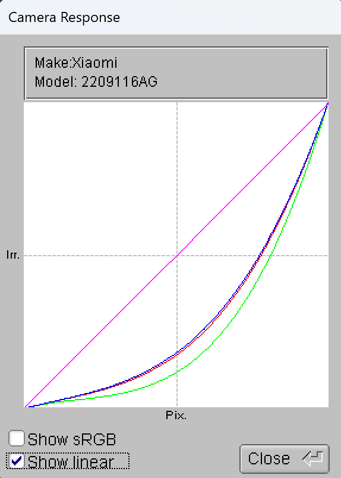

# Image Capture
My phone is Redmi Note 12 Pro, Xiaomi.
To capture images, I did not use any software. I simply opened the pro settings, leaned my phone to a bottle so that I could choose exposure and take pictures without picking it up. I chose nearly every possible exposure while setting ISO to 50. It was night and flash was off. 

Of course, the phone did move a bit especially in the first few pictures. But it was subtle and did not require any alignment.

The picture shows my TV, my framed puzzle and balcony. With high exposure images, it is possible to see the buildings across my balcony. To my luck, someone opened and closed their light a few times during capture. Same as my internet router superbox which had blinking blue lights.
# Algorithm
## Part 1: Understanding the Algorithm

## Part 2: Speeding up

## Part 3: Missing Pieces

## Part 4: Results
### Final parameters

### Comparisons

### Time
mine: Total (load + calibration): 11.60 s
nikon coolpix: Total (load + calibration): 6.11 s
linear (no noise): Total (load + calibration): 1.31 s
srgb: Total (load + calibration): 4.69 s 
canon: Total (load + calibration): 5.97 s
