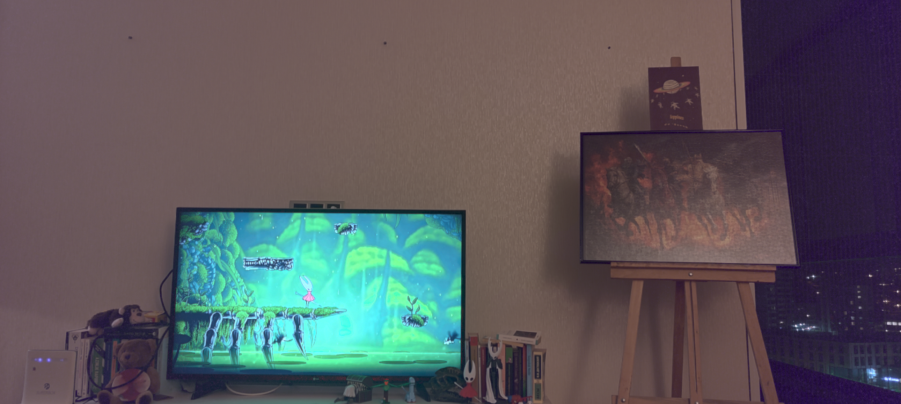

# Image Capture
My phone is Redmi Note 12 Pro, Xiaomi.
To capture images, I did not use any software. I simply opened the pro settings, leaned my phone to a bottle so that I could choose exposure and take pictures without picking it up. I chose nearly every possible exposure while setting ISO to 50. It was night and flash was off. 

Of course, the phone did move a bit especially in the first few pictures. But it was subtle and did not require any alignment.

The picture shows my TV, my framed puzzle and balcony. With high exposure images, it is possible to see the buildings across my balcony. To my luck, someone opened and closed their light a few times during capture. Same as my internet router superbox which had blinking blue lights.

The tonemapped photo and the response curve I got from bracket for my exposure sequence are below.

Sadly I could not perfect my implementation so the result from there is not as reliable.

# Implementation
I chose Python because c++ requires memory handling which can cause very annoying errors. Trying to speed up Pyhton proved to be as annoying. I also could not implement skipping vignett and motioned pixels. 

## Part 1: Understanding the Algorithm
During this process, I started with manual loops to understand the idea of the general algorithm. The paper, though it seems complete did overlook many parts. For example, the epsilon that is required to determine convergence was left undetermined. 

Everything is defined under a class to avoid constant parameter passing.

### Main loop

ˋˋˋ    def response_function(rm):
        rm.errors = [float('inf') for _ in range(LIMIT_F+1)]
        rm.coeff_final = [[] for i in range(LIMIT_F+1)]
        rm.Rs = [[] for i in range(LIMIT_F+1)]
        for deg in range(1,LIMIT_F+1):
            print(f"Degree: {deg}")
            rm.degree = deg
            rm.new_iteration()
            rm.R_est_list = rm.R_est_list_orig.copy()
            #polynomial degree
            rm.coeff = [0 for i in range(rm.degree+1)]
            for _ in range(LIMIT_R):
                # r est coeff computation loop
                rm.update_coeff()
                rm.update_R_est()
                if rm.R_is_converged():
                    break

            rm.update_coeff()
            rm.errors[rm.degree] = rm.compute_error()
            rm.coeff_final[rm.degree] = rm.coeff.copy()
            rm.Rs[rm.degree] = rm.R_est_list.copy()
            print(f"Error: {rm.errors[rm.degree]}.\n Coeffs: {rm.coeff_final[rm.degree]}")
        rm.final_degree = rm.choose_best()
        ˋˋˋ

### Choosing the Best parameter
This function is quite simple. I compare the precomputed errors and choose the smallest.

This is the part that I think might be faulty. Because my linear response function is very feasible and close to reality while the algorithm keeps choosing the biggest degree result. Maybe the answer wasn't directly comparing the degree errors but to do something additional. 

I would think lower degrees would have priority since there are more degrees, possibly adding up to the overall sum. Apparently that is not the case or something is wrong with the code. Maybe I should've recomputed errors with the final ratios.

## Part 2: Speeding up

## Part 3: Missing Pieces

## Part 4: Results
### Final parameters

### Comparisons

### Time
mine: Total (load + calibration): 11.60 s
nikon coolpix: Total (load + calibration): 6.11 s
linear (no noise): Total (load + calibration): 1.31 s
srgb: Total (load + calibration): 4.69 s 
canon: Total (load + calibration): 5.97 s
