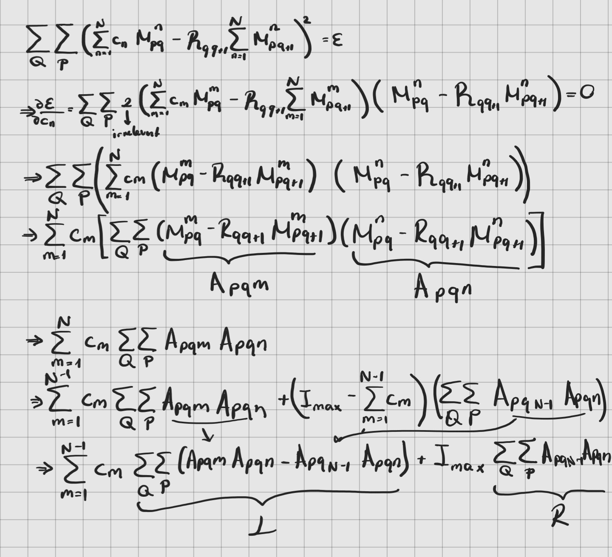
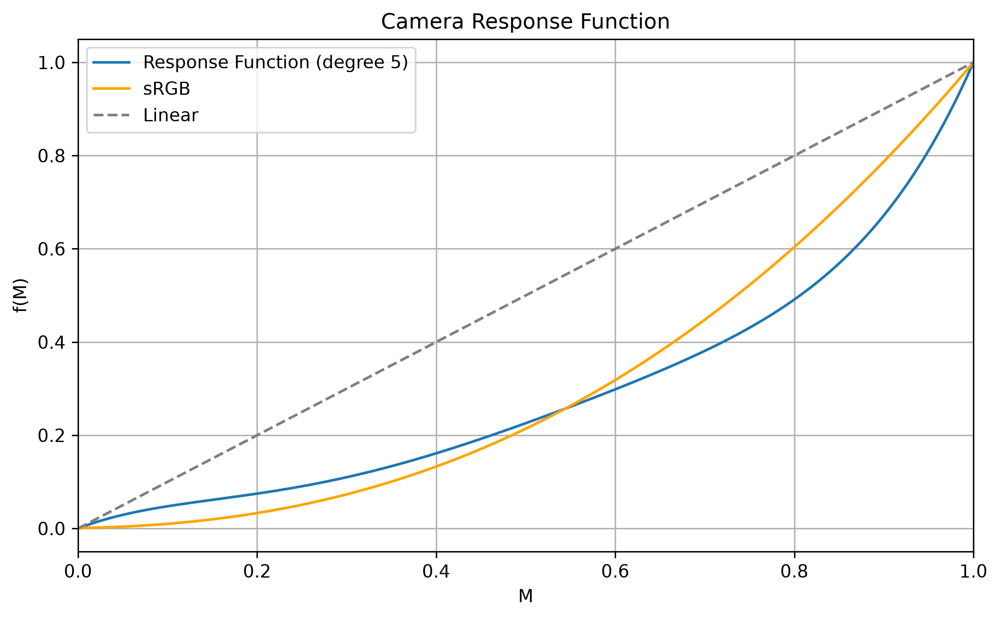
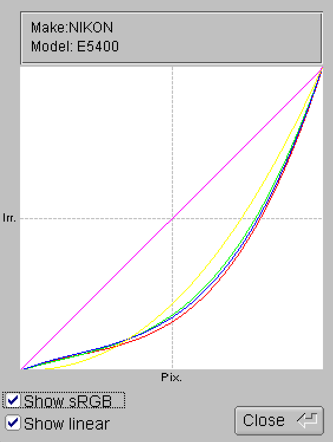
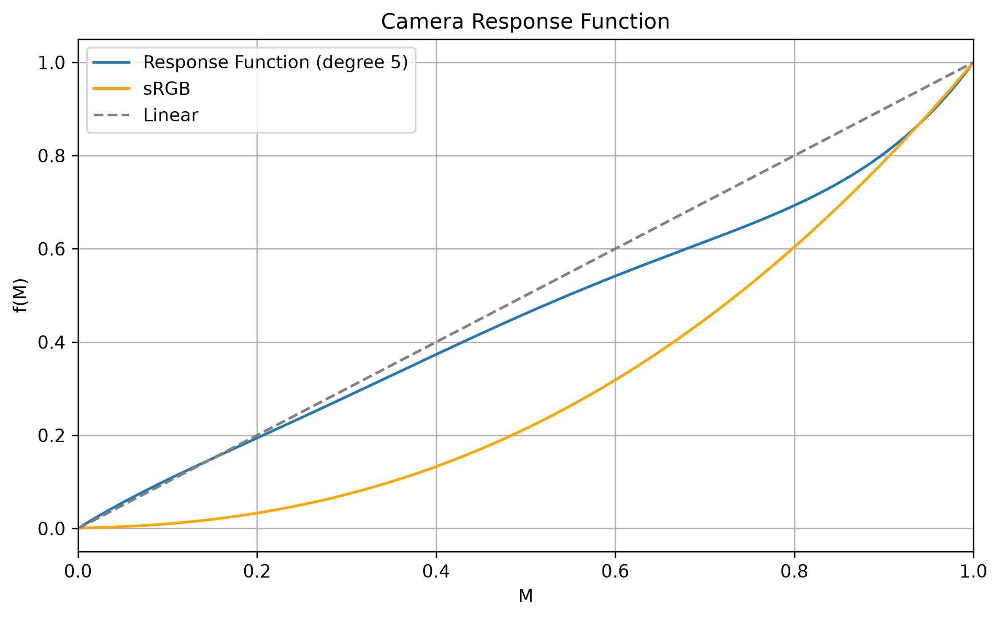
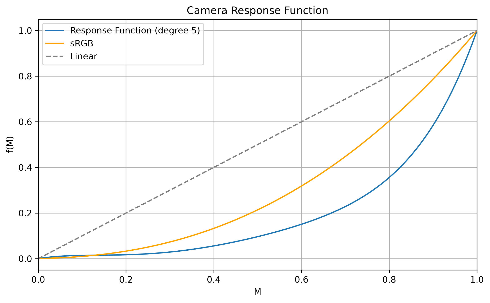
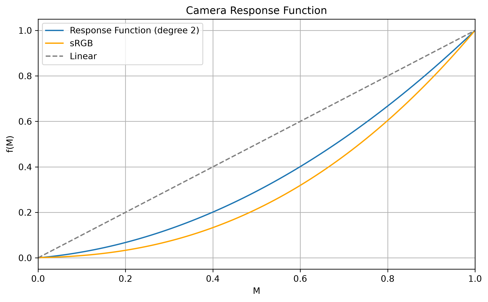

# Image Capture
My phone is Redmi Note 12 Pro, Xiaomi.
To capture images, I did not use any software. I simply opened the pro settings, leaned my phone to a bottle so that I could choose exposure and take pictures without picking it up. I chose nearly every possible exposure while setting ISO to 50. It was night and flash was off. 

Of course, the phone did move a bit especially in the first few pictures. But it was subtle and did not require any alignment.

The picture shows my TV, my framed puzzle and balcony. With high exposure images, it is possible to see the buildings across my balcony. To my luck, someone opened and closed their light a few times during capture. Same as my internet router superbox which had blinking blue lights.

The tonemapped photo and the response curve I got from bracket for my exposure sequence are below.

The tv was the bright part and the buildings seen from the balcony are the darkest parts. My camera is not the best, especially at night.


Sadly I could not perfect my implementation so the result from there is not as reliable.

# Implementation
I chose Python because c++ requires memory handling which can cause very annoying errors. Trying to speed up Python proved to be as annoying. I also could not implement skipping vignett and motioned pixels. 

## Part 1: Understanding the Algorithm
During this process, I started with manual loops to understand the idea of the general algorithm. The paper, though it seems complete did overlook many parts. For example, the epsilon that is required to determine convergence was left undetermined. 

Everything is defined under a class to avoid constant parameter passing.

### Main loop
The idea is as follows:
1. STart with degree = 1.
2. Compute coefficients
3. Re-estimate ratios
4. Check if ratios converged, if not return to 1.
5. If converged, increment the degree and return to 1 until degree is in its max value
6. Compare the errors and choose the coefficient list with the smallest error.

```  
def response_function(rm):
        rm.errors = [float('inf') for _ in range(LIMIT_F+1)]
        rm.coeff_final = [[] for i in range(LIMIT_F+1)]
        rm.Rs = [[] for i in range(LIMIT_F+1)]
        for deg in range(1,LIMIT_F+1):
            print(f"Degree: {deg}")
            rm.degree = deg
            rm.new_iteration()
            rm.R_est_list = rm.R_est_list_orig.copy()
            #polynomial degree
            rm.coeff = [0 for i in range(rm.degree+1)]
            for _ in range(LIMIT_R):
                # r est coeff computation loop
                rm.update_coeff()
                rm.update_R_est()
                if rm.R_is_converged():
                    break

            rm.update_coeff()
            rm.errors[rm.degree] = rm.compute_error()
            rm.coeff_final[rm.degree] = rm.coeff.copy()
            rm.Rs[rm.degree] = rm.R_est_list.copy()
            print(f"Error: {rm.errors[rm.degree]}.\n Coeffs: {rm.coeff_final[rm.degree]}")
        rm.final_degree = rm.choose_best()
```

You will notice everything is single channel. That is necause I initially turned the image into grayscale to simplify things and it stayed that way. 

### Coefficient Computation
This part is essentially about constructing two matrices, L and R:

```
L C = R
```

where $c_i$ is the elemt of C for 1 < i < n-1. I omitted 0th and nth coefficients. 0, because I wanted it to start from 0 (after several tests) and 1 because I set f(1)= 1 as the paper suggested.  

R is originally zero since we are taking the derivative of the error function according to every coefficient and setting it to zero. However, when we set f(1)=1 and therefore c_N = Imax - sum(C - c_N), there are some constants left in the equation which are transferred to R.

The math derivation:



Computation of a single row of L:

```
L_n = []  
        for m in range(rm.degree):
            tot = 0
            for q in range(rm.Q-1):
                for p in range(rm.P):
                    tot += (A[q][p][m]-A[q][p][rm.degree])  + (A[q][p][n]-A[q][p][rm.degree])
            L_n.append(tot)
```
Where A[q][p][m] = M_{p,q}**m - R_{q,q+1} * M_{p,q+1} ** m. 

Essentially we take the derivative according to c_i and write the resulting equation as a row of this matrix. For c_N, we eliminate it by writing $Imax - sum(C - c_N)$ and add the coefficients resulting from this substitution to the left array. If there are terms without the coefficients, we move it to the right-hand-side of the equation, i.e. to R.

Finally, the resulting linear system is solved with

```
C = np.linalg.solve(L,R)
c_N = I_max - np.sum(C) # simplified line
C = list(C) + [c_N]
```


### Ratio Estimation
Here, we compute a nominator and a denominator using the freshly calculated coefficients. I just summed every ratio I got from testing the function with each pixel in every exposure pair.

```
def update_R_est(rm):
        rm.R_est_list_prev = rm.R_est_list.copy() 
        for q in range (rm.Q - 1):
            res = 0
            for p in range(rm.P):
                num = 0
                den = 0
                for n in range(rm.degree+1):
                    num += rm.coeff[n] * rm.M[p][q]**n
                    den += rm.coeff[n] * rm.M[p][q+1]**n
                if abs(den) < 1e-12:
                    print("Denominator was zero!!")
                else:
                    res += num/den
            rm.R_est_list[q] = res
```

Maybe simply taking the difference of the old and the new ratios could be an option that I did not think about before but paper does state f(M).

Or I could test f for each value (0-255) and compute an error that way. This comparison and error computation does seem arbitrary to me or maybe I'm thinking too much.

### Choosing the Best parameter
This function is quite simple. I compare the precomputed errors and choose the smallest.

This is the part that I think might be faulty. Because my linear response function is very feasible and close to reality while the algorithm keeps choosing the biggest degree result. Maybe the answer wasn't directly comparing the degree errors but to do something additional. 

I would think lower degrees would have priority since there are more degrees, possibly adding up to the overall sum. Apparently that is not the case or something is wrong with the code. Maybe I should've recomputed errors with the final ratios.


## Part 2: Speeding up
I then started to use numpy, which looks very similar to Matlab notation. This sped up things reasonably well and I started to test frequently. And tested some other options. One of them was setting f(0) to be 0. Even without that the results were not monotonically increasing despite the assumption.

I started to omit pixels that are too close to borders (0 and 255) because over or underexposed pixels do not help with the ratios. I also ommited the result for ratio estimation when the denominator was too small.

## Results
The results are under the outputs folder. To speed up the process, I chose maximum degree to be 5. Every tour with a bigger degree takes exponentially more time.

The times include image loading. 

Result of Nikon Cookpix E5400 from implementation (6.11s):


Result from bracket:


Result of the virtual linear camera from implementation (1.31s):


Result of my camera from implementation (11 images) (11.6s):



Result of the virtual srgb camera from implementation (4.69s):


All time, curve and coefficient results are stored under the outputs folder. 

The results are not too far away from the reality, they lean towards the correct way and usually do not ripple unnecessarily. 

## Conclusion
I think apart from some arrangments the code is really close to working. And the main idea is there. 
